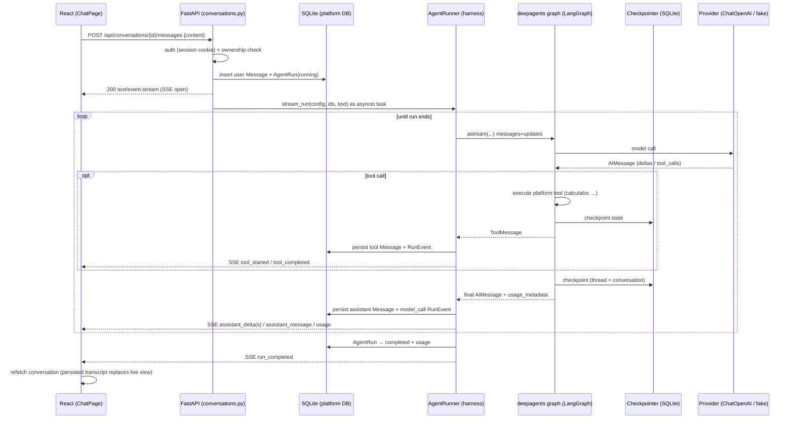

# 05 — Request Lifecycle (chat message)

The complete path of one user message, with owners of each state transition.

## Who owns what

| Transition | Owner |
|---|---|
| Auth/ownership decision | `api/deps.py` (`CurrentUser`, `OwnedConversation`) |
| Creating run + user message (atomic) | API handler, committed **before** streaming starts |
| Driving the graph | `AgentRunner.stream_run` via the `_drive` task |
| Transcript rows (`messages`) | runner, committed per message while streaming |
| Trace rows (`run_events`) | runner (`model_call`, `run_*` events) |
| Run status (`running→completed/failed/cancelled`) | runner `_finalize`, in its own session |
| Checkpoint state | LangGraph checkpointer (framework-owned, opaque to the platform) |
| SSE delivery + disconnect | `StreamingResponse` generator + queue; disconnect cancels the run task |

## Where it can fail, and what the user sees

1. **Auth/ownership (before run)** — plain 401/404, no run created.
2. **Provider not configured** — run created, `run_failed` SSE event with
   `provider_not_configured`; transcript keeps the user message.
3. **Mid-stream provider error** — `run_failed` with a classified code;
   partial transcript and trace remain inspectable.
4. **Client disconnect / Stop** — run task cancelled, run marked `cancelled`,
   partial transcript kept.
5. **Process crash/restart** — startup sweep marks orphaned `running` runs
   `failed(server_restarted)`; the checkpoint lets the conversation continue.

## One active run per conversation

The handler rejects a second concurrent run with 409 while one is `running`.
Combined with the startup sweep this keeps the checkpointer thread and the
transcript unambiguous. (Multi-run concurrency is future work.)
